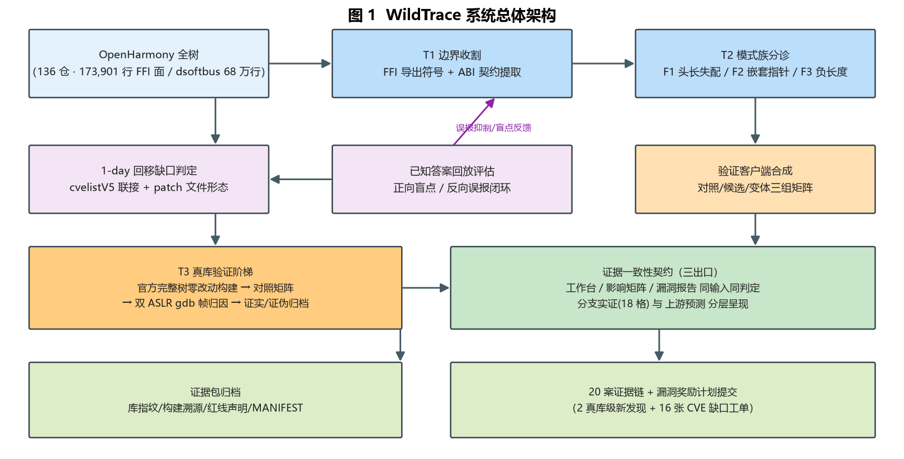
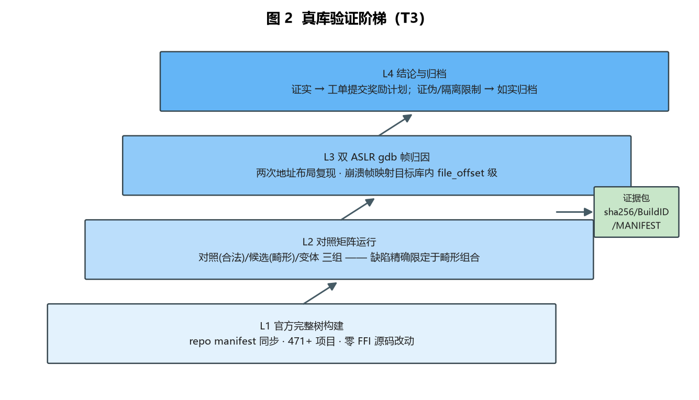

# 中国研究生网络安全创新大赛 作品报告（初版 · 2026-10-11）

> **作品名称**：WildTrace：面向 OpenHarmony 仓颉 FFI 边界的自动化漏洞挖掘与验证系统
> **提交日期**：2026-10-XX（占位）
> **格式提醒**：终稿需 A4、宋体小四、1.5 倍行距；不得出现学校/院系/指导教师身份信息；本初版为内容底稿，图表位以【图 N】占位。

---

## 摘要

OpenHarmony 是首个达到大规模商用的新兴开源操作系统，生态设备规模达亿级。随着 HarmonyOS NEXT 完成应用层语言换代——以仓颉（Cangjie）语言替换 Java——应用与仍以 C/C++ 实现的系统组件之间出现了一个**全新的跨语言 FFI 攻击边界**：仓颉侧以 `CArrXxx = {head, size}` 等结构化参数跨越边界调用原生代码，而语言类型系统的"非空、长度正确"保证在边界对端全部失效。该边界任何应用可达、以内存不安全语言实现、按接口而非按字节消费输入，却没有任何自动化挖掘工具覆盖。

本作品实现了覆盖"收割 → 分诊 → 验证"全链路的自动化漏洞分析系统 WildTrace：**（T1）自动化边界收割**——对 136 个仓库 173,901 行完成 FFI 导出函数与 ABI 契约的规模化提取；**（T2）ABI 契约感知的模式族分诊**——将边界缺陷归纳为三类校验缺失模式族（数组头长失配、嵌套指针、负长度下溢），并为每个候选合成逐字对齐 ABI 的验证客户端；**（T3）真库验证阶梯**——在官方完整树（零 FFI 源码改动）构建的真实库上以对照矩阵与双 ASLR gdb 帧归因将候选升级为可评审证据，证伪同样如实归档。系统另含 1-day 回移缺口判定线与已知答案回放的检测质量度量协议。

在 OpenHarmony 分布式软总线（68 万行）上的实测产出 2,662 条 lead（误报治理后自 3,033 条收敛，检测器质量由回放评估独立度量）；在真实库上完成 6 个高价值目标的验证，产出 **2 项真库级证实的新发现漏洞**（均按负责任披露流程提交 OpenHarmony 安全漏洞奖励计划）与 2 项诚实证伪；另向漏洞奖励计划提交 16 张已公开 CVE 的下游缺口工单，形成 20 案证据链与 20 案 × 6 版本分支的**证据分层**影响矩阵（18 格分支实证与上游版本预测独立呈现，三出口同输入同判定由契约测试锁定）。

**关键词**：仓颉 FFI；跨语言边界；OpenHarmony；漏洞挖掘；真库验证；证据链

---

## 第一章 作品概述

### 1.1 背景分析

#### 1.1.1 OpenHarmony：规模化商用的新兴开源操作系统

OpenHarmony 是开放原子开源基金会孵化及运营的开源项目，由华为捐赠核心代码、社区共建，是 HarmonyOS 生态的技术底座。据官方披露，OpenHarmony 生态设备规模已达**亿级**，覆盖手机、平板、穿戴、智能家居、车机等多种设备形态。其官方代码仓库（openharmony.cn/download）包含 **471+ 项目**，主干以版本快照方式引入 200 余个 third_party 开源组件（ffmpeg、openssl、curl、cJSON 等），代码库规模庞大、复杂度高，日常迭代中安全性的保障难度远超一般开源项目。

与传统移动操作系统不同，OpenHarmony 采取了"全栈开源 + 多语言并存"的技术路线：系统组件以 C/C++ 实现并经由内部接口暴露能力，应用层语言历经 Java → 方舟 TS（ArkTS）→ 仓颉（Cangjie）的演进，分布式能力则通过软总线（dsoftbus）等中间件横向打通。这种异构性带来了独特的攻击面：**攻击者不需要攻破任何单一组件，只需要找到语言与语言之间、组件与组件之间那些"两不管"的边界**。

#### 1.1.2 语言换代产生的全新攻击面：仓颉 FFI 边界

HarmonyOS NEXT 于 2024 年商用，完成了以**仓颉语言替换 Java**的应用层语言换代。仓颉是面向 NEXT 世代的应用与系统开发语言，正在逐步覆盖打点上报、分布式数据、多媒体等系统框架。然而系统组件仍以 C/C++ 实现，两侧通过 **CJ FFI（外部函数接口）** 衔接：仓颉代码调用 FFI 导出函数，以结构化参数传递数据。

以打点组件 HiAppEvent 为例，仓颉侧注册事件过滤器时传入 `CArrAppEventFilter = { CAppEventFilter *head; int64_t size; }`——一个"数组头指针 + 长度"的结构对。该边界具有三重脆弱性：

1. **契约失效**：仓颉类型系统保证传入的数组非空、长度正确；C 侧实现因此普遍信任 `{指针, 长度}` 对的良构性，直接进入遍历循环——`head=NULL 且 size>0` 的畸形组合到达时立即空指针解引用；
2. **应用可达**：FFI 导出函数对任意第三方应用可达，无需特殊权限、无需用户交互；
3. **审计真空**：相关代码全新、无历史审计沉淀；仓颉太新，主流静态分析器不掌握其 ABI 约定，模糊测试的输入模型无法触达接口级结构化参数。

这不是孤例。与 IPC（WriteByteArray）、AVSession（SendCommonCommand）、UDMF（SetProperties）等组件的 FFI 接口具有完全同构的风险形态——这构成了一个**类**问题：**仓颉 FFI 边界的参数校验缺失族**。

#### 1.1.3 问题的两翼：0-day 新攻击面与 1-day 下游缺口

除新攻击面上的未知漏洞（0-day）外，OpenHarmony 还面临已知漏洞的下游暴露问题：主干以旧版本快照引入 third_party 组件，上游修复 CVE 后 OpenHarmony 是否真正回移是**不透明**的——回移经常不走上游 commit，而是以仓库根目录 `Fix-/Backport-CVE-*.patch` 文件 + BUILD.gn 的形式存在，导致基于 commit 或版本号比对的工具系统性误报。"哪些已知漏洞在 OpenHarmony 上仍然开放"这一基础问题，此前缺乏可靠的自动化回答手段。

本作品将上述两翼纳入统一方法论：**判定（哪些已知漏洞仍暴露）→ 发现（在新攻击面挖掘未知漏洞）→ 验证（以运行级证据链将候选转化为可提交漏洞）**，集中实现于工具 WildTrace。

### 1.2 相关工作

#### 1.2.1 移动操作系统原生接口面的自动化挖掘

**FANS**（USENIX Security 2020）自动化收集 Android 原生系统服务的 Binder 接口（含深层嵌套），经语义建模与依赖处理后定向模糊测试，发现 168 个问题（30 个原生漏洞）。**NASS**（USENIX Security 2025）以反序列化引导的接口提取与覆盖反馈将此类挖掘扩展至全部 Android 原生服务。两代工作确立了"接口提取 → 语义建模 → 定向验证"的方法论共识，但其对象全部为 Android/Binder；本作品所面对的 CJ FFI 接口与 Binder 接口同构（应用语言 ↔ C++ 的结构化参数边界），而 OpenHarmony 侧此前无任何对应工具。

#### 1.2.2 跨语言 FFI 边界安全

Qin 等（IEEE S&P 2020）对真实世界 Rust 程序 unsafe 代码的实证研究表明，"安全语言的 unsafe 边界"是真实且反复被证明的漏洞来源；Mergendahl 等（NDSS 2022）定义了跨语言攻击威胁模型，证明 C/C++ 侧的内存加固可被 FFI 对端绕过。该方向证实了语言边界的风险通则，但均为实证或防御视角，对象为 Rust/Go；全领域尚无对特定生态 FFI 边界做**攻侧系统挖掘**的先例，仓颉方向的安全研究为零（现有仓颉学术工作集中于语言设计与代码翻译）。

#### 1.2.3 1-day 漏洞与补丁存在性判定

**VUDDY**（ICSE 2017）以补丁粒度的代码克隆匹配检测已修复漏洞是否仍存在；Zhang 等（USENIX Security 2018）在二进制中判定特定安全补丁是否存在。两者回答"漏洞代码是否在场/补丁是否含于二进制"，但不回答**下游是否以自有形态真正回移**（如 OpenHarmony 的 patch 文件形态），也不为每个结论生成运行级证据。

#### 1.2.4 OpenHarmony 安全研究现状

ArkAnalyzer（ICSE 2025 SEIP）与 HapCheck（ICSE 2026 SEIP）分别提供 ArkTS/HAP 应用层的静态分析与缺陷检测——这是 OpenHarmony 安全研究在顶级会议上的全部代表作，均位于应用层。原生组件层、FFI 边界与供应链缺口三个子方向无论文、无工具。通用静态扫描器（Semgrep/CodeQL/clang-tidy）不掌握 CArrXxx 契约与 OH 回移形态，在本场景中或无法触达（FFI 结构化参数）或误报偏高（我们实测 OSV 版本匹配 0 条、CPE 式比对 47 条全为过报）。

### 1.3 本文贡献

1. 定义并系统刻画仓颉 FFI 边界的威胁模型与三类校验缺失模式族，完成该攻击面的首个系统性攻侧挖掘；
2. 实现三段式自动化管线（边界收割 / 模式族分诊 / 真库验证阶梯）与 1-day 回移缺口判定线，全链路对应赛题六项能力要求（识别 → CWE/CVE 归类 → PoC → 影响评估 → 修复建议 → 报告生成）；
3. 产出 2 项真库级证实的新发现漏洞（已提交官方漏洞奖励计划）与 16 张 CVE 缺口工单，形成 20 案五段式证据链与证据分层影响矩阵，并将证据质量与三出口证据一致性变为可度量、可回归的工程属性；
4. 提出已知答案回放的检测质量度量协议，并以误报治理实测（3,033 → 2,662 条，宏守卫扩展精确消除 229 条）验证检测器的可解释性与可修正性。

---

## 第二章 作品设计与实现

### 2.1 作品使用技术及原理

#### 2.1.1 ABI 契约感知的检测原理

本作品检测层的核心思想是：**FFI 边界的缺陷模式由 ABI 契约推导，而非通用代码模式**。仓颉 FFI 的输入契约以固定形态的结构体族表达，我们从中归纳出三类校验缺失模式族：

- **F1 数组头长失配**：`{head, size}` 对中 head=NULL 而 size>0 时，C 侧循环 `for (i = 0; i < size; i++) head[i]` 直接解引用。最普遍的形态（IPC WriteByteArray、HiAppEvent AddWatcher 均为此型）；
- **F2 嵌套指针**：参数包结构（如 `CParameters = {valueType, key, value, size}`）中 value 指向的内部数组在分发前未判空——比外层深一级（AVSession SendCommonCommand 的 CArray→CParameters 分发）；
- **F3 负长度下溢**：size<0 经隐式转换变为 size_t/uint32 的巨值（4,294,967,295 级），导致巨循环或巨拷贝（bluetooth StartBleScan 的负 size 变体）。

检测器按模式族对源码逐函数扫描（轻量解析 + 注释/字符串掩码 + 调用图增强），每条 lead 附带可解释的置信度因子（如"+25 9 处 post-free 使用；+10 post-free 写入"）与触发提示（如"`{head=NULL, size=1}`"），供分诊与 PoC 生成直接使用。

#### 2.1.2 真值宏守卫与误报抑制

OpenHarmony 代码大量使用前缀化的真值检查宏族（`AUTH_/TRANS_/NSTACKX_CHECK_AND_RETURN*(cond, ...)`）做空指针防护，其形态对通用扫描器不可见。我们实现了**按宏名极性判定的守卫识别**：裸变量式（`CHECK_*(param, ...)`）与前缀族一律识别为防护；条件式（`param ==/!= NULL`）仅当宏名携带 RETURN/RET 语义（返回型守卫）时才抑制——`CHECK_INVOKE(param != nullptr)` 这类"非空才动"的调用型宏不构成空防护，不抑制。该设计由已知答案回放驱动（见 3.3.3），并在 dsoftbus 上实测精确消除 229 条误报。

#### 2.1.3 知识库联接与版本影响判定

1-day 线以 CVE 编号联接 cvelistV5 知识库记录，按边界语义（起点 ≤ 基线 < 修复点）逐分支判定；分支基线来自各 OpenHarmony 发布分支 README.OpenSource 的实测普查。判定遵循三条诚实规则：**不跨组件借用基线**（某分支缺该组件数据时判 ？，不用其他组件版本号顶替——旧实现的兜底曾造成全红假象，已作为审计 P0 修复）；**？不是安全结论**（待定格显式标注缺失证据与升级路径）；**证据分级**（🔴 证实 affected / — 证实不受影响 / ？ 待定）。

### 2.2 系统方案

系统由三段管线、两条辅线与一个本地工作台组成。

#### 2.2.1 T1 自动化边界收割

扫描目标仓库全集（136 仓 / 173,901 行 / 272 秒），提取 FFI 导出函数符号（`FfiOHOS*` 族）、ABI 结构体契约与调用位置，形成带高危分级的接口清单（380 条 lead，高危 84）。收割结果直接服务于 T2 分诊排序。

#### 2.2.2 T2 模式族分诊与验证客户端合成

按三类模式族对 lead 分桶分批（Tier 制推进），对每个候选**合成逐字对齐 ABI 的验证客户端**：本地构造 C 结构、dlopen 打开真库导出符号直调，内含对照/候选/变体三组输入矩阵，不复制任何目标实现代码。客户端对崩溃 case 置尾以保证崩溃归因标记。对置信度 ≥50 的 lead 管线自动生成模板 PoC；LLM PoC 生成作为增强路径（见 2.3）。

#### 2.2.3 T3 真库验证阶梯

将候选升级为可评审证据的四级阶梯：

1. **官方完整树构建**：以 repo manifest 同步的官方完整树（471+ 项目、官方构建链、**零 FFI 源码改动**）构建目标库，杜绝隔离树 mock 补丁对崩溃归因的污染；
2. **对照矩阵运行**：验证客户端在真库上运行对照（合法输入）/ 候选（畸形输入）/ 变体三组，缺陷必须精确限定于畸形组合（如"head=NULL 且 size>0"），对照组合法返回；
3. **双 ASLR gdb 帧归因**：两次不同地址布局下复现，崩溃帧必须映射落在目标库内（file_offset 级），排除 musl 运行库与适配层的干扰；
4. **结论与归档**：证实 → 生成工单材料提交漏洞奖励计划；证伪（FFI 层参数检查拦截了全部畸形输入）或隔离限制 → **如实归档**——证伪同样是有价值的产出，它关闭了候选的产品影响主张。

每案记录库指纹（sha256/BuildID/导出符号数）、构建溯源（裸仓 HEAD 构建提交 + manifest 分支）与红线声明（隔离环境、无产品服务、自定义构建配置），形成完整的证据包（含 gdb transcripts、运行日志、输入哈希与 MANIFEST）。

#### 2.2.4 1-day 回移缺口判定与影响矩阵

对 20 案 × 6 分支（v4.1/v5.0/v5.1/v6.0/v7.0/master）生成**证据分层**影响矩阵：主表为分支判定（严格口径，仅计 per-branch 实证），另设独立标注的"上游版本预测"区（版本级风险线索，不作为分支结论）。当前 **🔴 分支实证 18 格**（18 案 master：12 ffmpeg 案 HEAD 0a0c4dd33c 三侧对照 + cjson 0c2c9df ASan 运行级 + curl 双案 f044ac3a + IPC/HiAppEvent/UDMF 真库级复现提交）/ ？ 102 格（各 release 分支待逐支核验，显式标注升级路径而非推断填充）。

三个出口（工作台 / 影响矩阵 / 漏洞报告）由 12 项三层契约测试锁定**同输入同判定**：版本信息可形成风险预测但不能代替分支证据；单一分支判定不扩散到其他分支；预测只出现在标注区、不得包装为已证实结论。openssl 案无 HEAD 钉定、仅有版本基线，按契约保持 ？（预测区可见）——该规则有牙齿的直接例证。缺口判定覆盖 OH 特有的 patch 文件回移形态。

#### 2.2.5 已知答案回放评估

以历史已知漏洞（bluetooth 仓 4 个已修复缺陷）回放检测器：正向度量盲点（0/4 命中 → 命名四类非裸指针形态盲点），反向度量误报（2 例 → 定位根因真值宏抑制缺失与智能指针参数建模缺失 → 修复闭环 13→12，精确移除目标误报、零误伤）。该协议可复用于任意目标仓，是检测质量的独立度量手段。

### 2.3 软件运行流程

工具提供 CLI 与本地工作台双入口。【图 3：工作台界面——扫描页/分诊页/产出页（截图随 DEMO 录制补入）】

- **CLI**：`python -m ohvul.autopilot <源码根>` 一条命令完成 10 层管线（调用图 → P1-P9 模式层 → 跨函数 UAF → 可选 Joern CPG → 报告与 PoC），输出 findings.json/md 与 pocs/；
- **本地工作台**（React + FastAPI，仅绑 127.0.0.1）：扫描任务（串行队列/实时进度/取消/中断恢复）→ 候选分诊（模式/CWE/置信度/状态筛选 + 源码片段详情抽屉 + 保留/误报标注）→ 产出（报告预览 / PoC 管理 / lead → 案例骨架）。LLM PoC 生成按需接入（密钥仅存后端内存、每次尝试含失败全量留痕并标注 model_invoked，模型输出仅作草稿不作结论）；
- **安全契约**：全流程仅本地读取、不执行目标代码（唯一的运行时验证轨道限定单一钉死案例 + bwrap 全隔离沙箱 + commit/哈希 preflight）、不持久化密钥，界面上 local_only / no_execution / no_network 徽章常驻。

工程规模：Python 10 层管线 + 前端工作台，1,107 项回归测试（含 12 项三出口证据一致性契约测试与 20 真案跨出口一致性断言），CI 全绿。

---

## 第三章 作品测试与分析

### 3.1 环境搭建

分析侧：Windows + WSL Ubuntu 双环境（Clang/Semgrep/Joern 工具链经环境探针预检）；真库验证侧：OpenHarmony 官方完整树（repo manifest 同步，471+ 项目），x86_64_virt 自定义构建配置，bwrap 隔离运行。

### 3.2 测试数据

- **主目标**：distributedhardware_dsoftbus（分布式软总线，681,529 行 C/C++）——OpenHarmony 核心网络组件，攻击面最大；
- **FFI 清扫集**：136 个含 CJ FFI 导出的仓库（173,901 行）；
- **回放评估集**：communication_bluetooth 历史已知漏洞（4 正向样本 + 全量 lead 反向复核）；
- **真库验证集**：IPC / HiAppEvent / UDMF / account / AVSession / KV 六个高价值目标。

### 3.3 结果分析

#### 3.3.1 大规模扫描与误报治理

dsoftbus 全树扫描（651.7s，~1,046 行/秒，峰值内存 176.4MB）初始产出 3,033 条 lead（高危 580）。经误报审计定位三类系统性问题并修复（**表 1**），治理后 **2,662 条 lead（高危 438）**，全部可归因到模式族且每条携带源码片段与可解释置信度因子。

**表 1  误报治理前后对比（dsoftbus 68 万行实测）**

| 指标 | 治理前 | 治理后 | 治理手段 |
|---|---|---|---|
| lead 总数 | 3,033 | 2,662 | 三项系统性修复（下行） |
| 高危 lead | 580 | 438 | 随宏守卫误报消除联动下降 |
| 宏守卫误报 | — | **精确消除 229 条** | 按宏名极性判定（前缀族 + 返回型条件式），与预测逐位吻合 |
| 同位置多变量碰撞 | 501 行 | 消除 | finding_id 纳入触发变量（另消 37 行重复） |
| 源码片段覆盖 | 部分 | 2,662/2,662 全覆盖 | 统一片段填充 |

#### 3.3.2 真库验证：四证实 / 两证伪 / 一隔离

| 目标 | 接口 | 畸形输入 | 真库结果 |
|---|---|---|---|
| IPC | WriteByteArray | data=NULL, len>0 | **SIGSEGV**（帧归因库内 0x1ed9b）→ 已提单 |
| HiAppEvent | AddWatcher | head=NULL, size>0 | **SIGSEGV**（帧归因库内 0x11c9a）→ 已提单 |
| UDMF | SetProperties | tag=NULL | **SIGSEGV**（std::string(nullptr)→strlen(NULL)，帧归因库内 0x1716f）→ 材料齐备待提单 |
| account | 四组畸形 | — | 证伪：全被 FFI 参数检查拦截 → 诚实归档 |
| AVSession | SendCommonCommand | value=NULL, size>0 | 证伪：入口层拦截（rc=-1011）→ 诚实归档 |
| KV | CArrStrToVector 族 | — | 隔离限制：调用链依赖不可构造的运行时上下文 → 源级归档 |

其中 UDMF 案附带 **round-trip 自毁论据**：`FfiUDMFSetProperties` 对空 tag 崩溃，而 `FfiUDMFGetProperties` 对空存储 tag 本来就返回 nullptr——**getter 的合法输出直接喂回 setter 必崩**，可达性论证从"恶意调用者"提升到"正常 API 使用模式"。

#### 3.3.3 回放评估与检测质量

正向：bluetooth 4 个历史已知漏洞回放命中 0/4——暴露四类检测盲点（非裸指针形态：局部智能指针/成员指针/宏展开取指针/智能指针参数），其中智能指针参数形态已修复（回归测试钉死）；反向：2 例误报根因定位（真值宏抑制缺失 + 智能指针建模缺失）并修复闭环，发现数 13→12，**精确移除目标误报、零误伤**。四类盲点已全部立账跟踪。

#### 3.3.4 1-day 缺口与影响矩阵

向漏洞奖励计划提交 16 张 CVE 缺口工单（curl×2、openssl×1、ffmpeg×12、ipc×1），全部附 PoC/patch/运行验证记录（三张含 ASan 实测矩阵），当前评审中。20 案 × 6 分支影响矩阵：**🔴 分支实证 18 格 / ？ 102 格**（release 分支待逐支核验，？不是安全结论），上游版本预测独立分层呈现；三出口由契约测试锁定同输入同判定（见 2.2.4）。

#### 3.3.5 证据质量度量

对 20 案 × 12 字段（CVE/描述/触发/路径/片段/PoC/用法/定位/修复/补丁/版本判定/真库复现）做出口级证据质量审计（工具化、可重跑）：回填奖励计划表单材料后，渲染层占位文案从 20 案降至 6 案（其中 5 案为如实标注的源级验证边界），"待补充"类模板行清零；20/20 案补齐验证级别如实标注的复现命令（运行级 ASan / 真库级 / 源等价 / 源级三侧对照）。证据质量与证据一致性因此成为**可度量、可回归的工程属性**，而非一次性的人工承诺。

### 3.4 总结

系统在真实大规模代码库上验证了全链路闭环：**3,033 条初始 lead → 误报治理 2,662 条 → 高价值目标真库验证 → 2 项真库级新发现 + 16 张缺口工单**，检测质量由独立回放协议度量，每一步收敛可解释、可复现。

---

## 第四章 创新性说明

### 4.1 新攻击面的定义与首个系统性挖掘

定义了仓颉 FFI 边界的完整威胁模型（契约失效 / 应用可达 / 审计真空三重脆弱性），归纳出三类校验缺失模式族，并完成该攻击面的首个系统性攻侧挖掘——相对于 FANS/NASS（Android/Binder）与 Rust 边界实证研究，这是"新语言落地 → 边界安全成为研究热点"规律在仓颉上的首次系统化落地。

### 4.2 ABI 契约感知的检测与极性宏守卫

检测规则从 FFI ABI 契约（结构体族语义）推导而非通用代码模式；误报抑制实现按宏名极性判定的守卫识别（返回型宏的条件式防护抑制、调用型宏不抑制），由回放评估驱动设计并在 68 万行实测中精确消除 229 条误报——检测器的每个判定可解释、每次修正可验证。

### 4.3 真库验证阶梯与 round-trip 可达性论据

将"发现"与"可评审证据"分级：官方完整树零源码改动构建 + 对照矩阵 + 双 ASLR 帧归因的四级阶梯，证实与证伪双向归档（证伪同样是产出——它关闭候选的产品影响主张）。UDMF 案的 round-trip 自毁论据（getter 合法输出回喂 setter 必崩）将可达性论证从"恶意调用者"提升到"正常 API 使用模式"，为同类边界缺陷提供了新的论证范式。

### 4.4 已知答案回放的检测质量度量

漏洞挖掘工具通常只报产出、不度量自身。本作品以历史已知漏洞回放检测器，正向命名盲点、反向定位并修复误报（13→12 精确闭环），形成可复用于任意目标仓的检测质量度量协议——检测器本身的可信度成为可测量对象。

### 4.5 1-day 回移缺口判定与证据一致性契约

对 OpenHarmony 特有的 `Fix-/Backport-CVE-*.patch` 文件回移形态建模，以 cvelistV5 知识库联接 + "不跨组件借基线"的诚实规则，输出**证据分层**影响矩阵（分支实证与上游预测两区互不覆盖）——"哪些已知漏洞在下游仍然开放"首次获得可判定的自动化答案。配套的三出口证据一致性契约（工作台/矩阵/报告同输入同判定，12 项三层测试锁定）确保"工具表达的结论"与"证据实际支撑的结论"严格对齐：上游版本推断永远不冒充分支实证，证据不足以 ？ 显式呈现。

---

## 第五章 总结

本作品面向 OpenHarmony 语言换代产生的新攻击面，实现了覆盖"收割 → 分诊 → 验证"的自动化漏洞挖掘与验证系统。核心成果：**2 项真库级证实的新发现漏洞**（IPC、HiAppEvent，均已按负责任披露提交 OpenHarmony 安全漏洞奖励计划，另 1 项 UDMF 材料齐备待提交）与 **2 项诚实证伪**；**16 张已公开 CVE 的下游缺口工单**（附 PoC/patch/运行验证记录，评审中）；dsoftbus 68 万行 2,662 条可解释 lead；20 案五段式证据链、证据分层影响矩阵（18 格分支实证 + 上游预测独立呈现）与可度量的证据质量/一致性契约；1,107 项回归测试与可用的本地工作台。

**不足与边界**：（1）真库级证实在隔离自定义配置下完成，产品可达性（真实仓颉调用方构造畸形参数的现实路径）为后续独立验证，全部案例如实声明该边界；（2）P8 同函数 UAF 启发式在异步回调型代码上仍存系统性误报形态（分支互斥 free / 回调闭包），已定位待抑制；（3）回放正向 0/4 暴露的四类非裸指针盲点中三类仍在攻坚；（4）影响矩阵 102 个 ？格为各 release 分支的未核验状态（非安全结论），升级路径为逐分支三侧对照核验；5 个源级案的运行级 PoC 升级各有明确硬前置（MSan 构建/码流构造/专用硬件），已如实记录路径而非宣称完成。

**未来工作**：结构感知的边界模糊测试（以 ABI 契约为语法做字段级变异，替代枚举式畸形组合）；盲点攻坚以提升回放正向命中；136 仓模式族分布的规模化测量研究；产品级可达性验证。

---

## 参考文献

[1] Liu B., Zhang C., Gong G., et al. FANS: Fuzzing Android Native System Services via Automated Interface Analysis. USENIX Security 2020.
[2] NASS: Fuzzing All Native Android System Services. USENIX Security 2025.
[3] Qin B., Chen Y., Yu Z., Song L., Zhang Y. Understanding Memory and Thread Safety Practices and Issues in Real-World Rust Programs. IEEE S&P 2020.
[4] Mergendahl S., Burow N., et al. Cross-Language Attacks. NDSS 2022.
[5] Kim G., et al. VUDDY: A Scalable Approach for Vulnerable Code Clone Discovery. ICSE 2017.
[6] Zhang H., Qian Z. Precise and Accurate Patch Presence Test for Binaries. USENIX Security 2018.
[7] Chen H., et al. ArkAnalyzer: The Static Analysis Framework for OpenHarmony. ICSE 2025 (SEIP).
[8] HapCheck: DSL-Based Static Bug Detection Framework for OpenHarmony. ICSE 2026 (SEIP).
[9] OpenHarmony 开源代码仓库. https://www.openharmony.cn/download
[10] OpenHarmony 安全漏洞奖励计划. https://bugbounty.openharmony.cn
